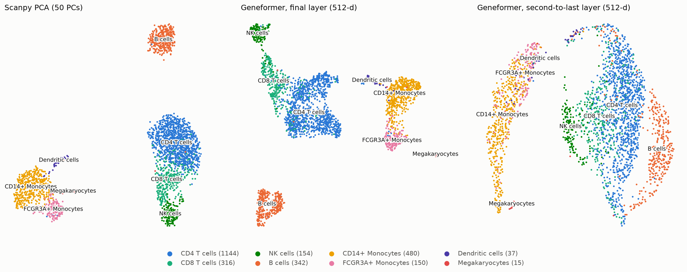

# Geneformer vs PCA on PBMC3k

**Question:** do zero-shot Geneformer cell embeddings, generated through the Helical SDK, separate known PBMC cell types better than a standard Scanpy PCA embedding?

**Answer: partly.** Geneformer places cells next to cells of the same type slightly more often than PCA does (kNN accuracy 0.947 vs 0.932, about 40 more of the 2,638 cells), and its cell types are more compact (silhouette 0.35 vs 0.19). The gain is concentrated in the hard cases: CD8 T cells, NK cells and FCGR3A+ monocytes. But clustering the Geneformer embedding recovers the published labels less well (best ARI 0.69 vs 0.86), because Leiden splits the CD4 T cells and merges the two monocyte subsets, and the labels themselves come from clustering a PCA of this dataset. With eight clusters, one per cell type, the two embeddings tie (ARI 0.61 each). The second-to-last Geneformer layer, which the original Geneformer documentation recommends for cell embeddings, did worse than the final layer on every metric.

## Result

The same 2,638 cells, 8 published cell types and metrics for every embedding ([`results/metrics.csv`](results/metrics.csv)):

| Embedding | Dims | kNN accuracy | ARI (resolution) | NMI (resolution) | Silhouette |
|---|---|---|---|---|---|
| Scanpy PCA | 50 | 0.932 | **0.860** (0.8) | **0.846** (0.8) | 0.193 |
| Geneformer `gf-12L-38M-i4096`, final layer | 512 | **0.947** | 0.686 (0.1) | 0.776 (0.1) | **0.346** |
| Geneformer `gf-12L-38M-i4096`, second-to-last layer | 512 | 0.864 | 0.578 (0.2) | 0.633 (0.2) | 0.041 |

- **kNN accuracy:** share of cells whose type wins the vote among their 15 nearest neighbours, with each cell held out (5-fold stratified cross-validation).
- **ARI / NMI:** agreement between the labels and Leiden clusters of a 15-neighbour graph, best over resolutions 0.1 to 2.0 (resolution in brackets; full sweep in [`results/leiden_sweep.csv`](results/leiden_sweep.csv)).
- **Silhouette:** how much closer cells are to their own type than to the nearest other type, by cosine distance, from -1 to 1.



Held-out kNN accuracy by cell type, and the wrong label each type most often receives ([`results/knn_per_cell_type.csv`](results/knn_per_cell_type.csv)):

| Cell type | Cells | PCA | Geneformer final layer | Geneformer second-to-last | Most often confused with (PCA / Geneformer final) |
|---|---|---|---|---|---|
| CD4 T cells | 1,144 | 0.99 | 0.97 | 0.97 | CD8 T: 1% / 2% |
| CD14+ monocytes | 480 | 0.99 | 0.97 | 0.96 | FCGR3A+ monocytes: 1% / 3% |
| B cells | 342 | 0.99 | 0.99 | 0.84 | CD4 T: 1% / 1% |
| CD8 T cells | 316 | 0.67 | 0.82 | 0.51 | CD4 T: 33% / 15% |
| NK cells | 154 | 0.84 | 0.94 | 0.84 | CD8 T: 16% / 6% |
| FCGR3A+ monocytes | 150 | 0.88 | 0.94 | 0.72 | CD14+ monocytes: 12% / 6% |
| Dendritic cells | 37 | 0.78 | 0.86 | 0.49 | CD14+ monocytes: 16% / 14% |
| Megakaryocytes | 15 | 0.80 | 0.73 | 0.47 | CD8 T: 13% / CD14+ monocytes: 13% |

A bar chart of the four metrics is in [`figures/metrics.png`](figures/metrics.png).

## Biological interpretation

Marker percentages are the share of each type's cells with at least one UMI of the gene ([`results/marker_detection.csv`](results/marker_detection.csv)). Cluster contents are in `results/leiden_composition_*.csv`, at each embedding's best resolution and at the first resolution that gives at least eight clusters. In this section "Geneformer" means the final layer; the second-to-last layer is covered at the end.

**B cells, CD4 T cells and CD14+ monocytes are separated well by both** (kNN accuracy 0.97 or higher). Each has clear markers: MS4A1 and CD79A (86% and 94% of B cells), CD14 and LYZ in monocytes, CD3E and IL7R in T cells.

**NK and CD8 T cells sit next to each other in both embeddings, which makes biological sense.** Both are cytotoxic lymphocytes: NKG7 is detected in 100% of NK and 91% of CD8 T cells, CCL5 in 73% and 93%, GZMA in 94% and 75%. What separates them is a handful of genes: GNLY (95% vs 30%) and FCGR3A (84% vs 22%) in NK cells, CD3E (40% vs 74%) and CD8A (8% vs 49%) in CD8 T cells. PCA's best clustering puts them in one cluster (154 NK and 255 CD8 T cells), and 16% of NK cells get a CD8 T label from their neighbours. Geneformer gives NK cells their own cluster (143 of 154 at its best resolution) and only 6% get a CD8 T label.

**CD8 vs CD4 T cells is the hardest call for both, partly because of the data.** CD8A is detected in only 49% of the labelled CD8 T cells (cells in this dataset have a median of 2,213 UMIs), and both types express CD3E and IL7R. A third of CD8 T cells get a CD4 T label from their PCA neighbours, against 15% from their Geneformer neighbours.

**CD14+ and FCGR3A+ monocytes are adjacent in both, which is also reasonable:** classical and non-classical monocytes are two ends of a continuum. They share LYZ and CST3 (about 100% of cells) and differ in CD14 (66% vs 15%), FCGR3A (15% vs 96%) and MS4A7 (27% vs 80%). Geneformer's neighbourhoods separate them slightly better (FCGR3A+ accuracy 0.94 vs 0.88), but its clustering merges them, while PCA's keeps them apart.

**Both embeddings split the CD4 T cells when clustered into eight groups, for different reasons.** PCA's split follows naive and memory markers: CCR7 is detected in 41% vs 30% of the two halves, S100A4 in 67% vs 92%. That is the naive/memory distinction the original Seurat tutorial makes. Geneformer's split does not (CCR7 36% vs 39%, S100A4 81% vs 77%). Its halves differ a little in genes detected per cell (median 834 vs 782), and I could not tie the split to biology.

**Why the clustering scores favour PCA.** ARI counts pairs of cells, so how the 1,144 CD4 T cells are grouped dominates it. At its best resolution, PCA keeps them together and pays mainly for merging NK with CD8 T cells. On the Geneformer graph, the resolution that separates CD8 T from CD4 T cells also splits the CD4 T cells, so Geneformer's best ARI comes from a coarse five-cluster partition by lineage (T, NK, B, myeloid, megakaryocytes), at the lowest resolution in the sweep. The labels were also made by clustering a PCA of this same data (see Limitations).

The rare types are hard for both. Dendritic cells (37 cells) are pulled towards CD14+ monocytes, with which they share LYZ and CST3; FCER1A (84% of dendritic cells, 1% of monocytes) tells them apart. Megakaryocytes (15 cells, PPBP in 100%) are too few to judge.

**Which Geneformer layer?** Helical's default, `emb_layer=-1`, is the model's final layer. The original Geneformer documentation recommends the second-to-last layer instead, because "the last layer is most specifically weighted to optimize the given learning objective". Helical rejects `emb_layer=-2`; for this 12-layer model that layer is `emb_layer=11` (see [SDK_NOTES.md](SDK_NOTES.md)). Here it was worse on every metric: kNN accuracy 0.864, best ARI 0.58, silhouette 0.04. B cells drop from 0.99 to 0.84 and CD8 T cells from 0.82 to 0.51. Its clusters partly follow how many genes each cell expressed rather than its type. At resolution 0.5 (nine clusters), one cluster mixes 65 CD4 T, 20 CD8 T and 18 B cells with a median of 424 genes detected, and the CD14+ monocytes split into two halves with medians of roughly 1,140 and 670 genes. I did not investigate further; the recommendation may still hold for other Geneformer models, tasks or pooling choices.

## Limitations

- **One small dataset.** 2,638 blood cells from one healthy donor, sequenced in 2016 (10x v1, median 2,213 UMIs per cell). Nothing here says how either method behaves on other tissues, deeper sequencing or data with batch effects.
- **The labels favour PCA.** The `louvain` labels come from clustering a PCA of highly variable genes from this same dataset, a very similar pipeline to the baseline, before the clusters were named from marker genes. PCA is partly scored against its own partition; Geneformer is not.
- **Zero-shot only.** Geneformer is used exactly as pretrained, with no fine-tuning on these cells or labels.
- **CPU-sized model.** `gf-12L-38M-i4096` has 38M parameters; the larger Geneformer models (104M, 316M) were not tried.
- **Gene coverage.** 86.7% of the genes detected here have an Ensembl ID in Geneformer's vocabulary (the 2016 annotation predates it). The rest are invisible to Geneformer but used by PCA.
- **Small differences, one split.** The kNN gap is about 40 cells and comes from a single 5-fold split; I have not tested whether it is robust to other splits.
- **Optimistic clustering scores.** ARI and NMI are the best of 20 resolutions, chosen using the labels. This treats all embeddings alike but overstates what an unsupervised analysis would get.
- **Distances.** kNN and the neighbour graph use Euclidean distance on the raw embeddings for both methods. The Geneformer embeddings are not normalised, and cosine distance might suit them better (not tested).

## Reproduce

Run with Docker on an Intel Mac (4 cores, 8 GB RAM); everything in `results/` and `figures/` was produced by these commands.

```bash
docker build -t pbmc-fm .
alias pbmc='docker run --rm -e OMP_NUM_THREADS=4 -v "$PWD":/work -v pbmc-fm-cache:/root/.cache pbmc-fm'

pbmc python scripts/01_prepare_data.py    # download PBMC3k, attach labels -> data/
pbmc python scripts/02_run_baseline.py    # Scanpy PCA embedding           -> results/
pbmc python scripts/03_run_geneformer.py  # Geneformer, 2 layers (~75 min) -> results/
pbmc python scripts/04_evaluate.py        # metrics, tables and figures    -> results/, figures/
```

- `pbmc python -m pytest` runs the tests (they download PBMC3k, not the model).
- Re-running these commands from a fresh clone reproduced every file in `results/` byte for byte. The PCA is only bit-identical at the same thread count: with 8 threads instead of 4, its values differ by up to 0.02, which moved ARI in the fourth decimal.
- Docker is needed on Intel Macs because `helical==3.1.3` pins `torch==2.10.0`, which has no Intel-Mac build. On an Apple Silicon Mac (macOS 14+) or Linux, `uv sync` installs the same locked versions natively; then run the scripts with `uv run python scripts/...`. That route resolves but was not tested here.
- `OMP_NUM_THREADS=4` is this laptop's number of physical cores. Docker reports 8 hyper-threads, and 8 PyTorch threads ran about half as fast.
- The `pbmc-fm-cache` volume keeps Helical's model files (153 MB, downloaded on the first Geneformer run).
- Two deliberate settings, both explained in [SDK_NOTES.md](SDK_NOTES.md). Geneformer runs with `batch_size=1`: same embeddings as batch size 16, 5x faster on this CPU. Helical's Ensembl ID collapsing is switched off because it fails on this dataset.
- On a laptop, keep the machine awake and cool during script 03 (for example with `caffeinate -is` on macOS). An earlier attempt here slowed to a crawl when the Mac overheated and went to sleep.

## Next steps

- **scib metrics.** The standard single-cell integration benchmark (for example isolated-label scores, cLISI and graph connectivity) would put these numbers on the same scale as published comparisons. Not installed here because it is heavy and Helical no longer depends on it.
- **A second dataset with batch effects.** PBMCs from several donors or technologies would test what pretrained models claim to be good at, separating biology from batch, rather than one clean sample.
- **Fine-tuning a classification head.** Helical supports fine-tuning Geneformer; training a small classifier on part of the labels would show whether the zero-shot gap closes with a little supervision.

What I learned about the Helical SDK along the way, including the fixes above, is in [SDK_NOTES.md](SDK_NOTES.md).
